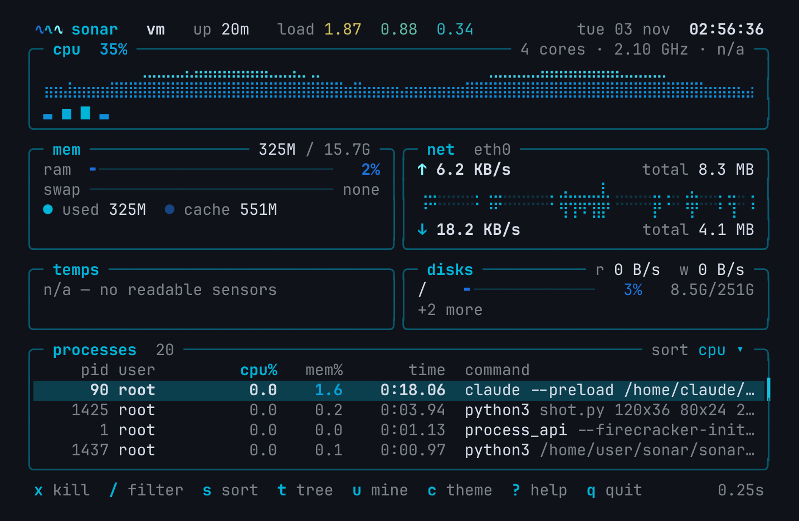
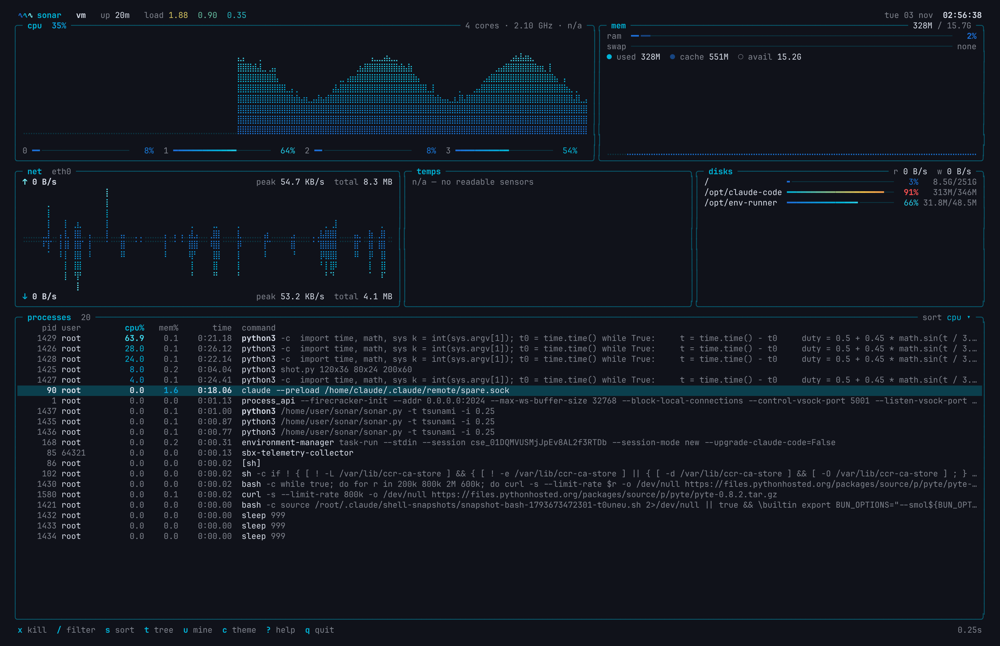

# sonar

Minimal system monitor for the Linux and Windows terminal, in the spirit of
htop / btop but quieter. It belongs to the same family as **waves** (system
fetch) and **tsunami** (terminal), and uses the same look and the same themes.


- **One file, no dependencies, two systems.** It's `sonar.py` plus the Python 3
  standard library. No psutil, no curses. On Linux it reads `/proc` and `/sys`
  directly; on Windows it calls the Win32 / NT APIs through `ctypes`.
- **Truecolor rendering with no flicker.** Each frame is built in memory and
  only the lines that changed are written. It runs on the alternate screen
  with the cursor hidden.
- **Light on resources.** It uses under 2 % CPU while idle (measured at about
  0.5 % at 80×24 and 1.6 % at 200×60 with 500 processes, refreshing every
  second).
- **Fits the terminal.** It adapts to the terminal size and redraws on resize.
  When space runs out it hides secondary panels instead of breaking the layout.
- **Runs without root.** Anything that can't be read shows a clean `n/a`.

## Install

sonar needs **Python 3.9 or newer** (tested on 3.9 and 3.13). Neither installer
needs root or administrator rights. Every method below is run by CI on each push.

### Linux

One line, no git needed:

```sh
curl -fsSL https://raw.githubusercontent.com/tfem1/sonar/main/install.sh | sh
```

Or with git:

```sh
git clone https://github.com/tfem1/sonar
cd sonar
./install.sh
```

Either way, sonar ends up in `~/.local/bin/sonar`; run it with `sonar`. If the
installer says `~/.local/bin` is not in your PATH, add
`export PATH="$HOME/.local/bin:$PATH"` to `~/.bashrc` or `~/.zshrc`.

To uninstall: `./install.sh --uninstall`, or
`curl -fsSL https://raw.githubusercontent.com/tfem1/sonar/main/install.sh | sh -s -- --uninstall`.

### Windows 10 / 11

One line in PowerShell, no git needed:

```powershell
irm https://raw.githubusercontent.com/tfem1/sonar/main/install.ps1 | iex
```

Or with git ([Git for Windows](https://git-scm.com/download/win), or `winget install Git.Git`):

```powershell
git clone https://github.com/tfem1/sonar
cd sonar
powershell -ExecutionPolicy Bypass -File install.ps1
```

sonar is installed in `%LOCALAPPDATA%\Programs\sonar` and added to your user
PATH; run it with `sonar` (open a new terminal first). Windows Terminal is
recommended. If Python is missing, the installer tells you how to get it
(`winget install Python.Python.3.13`).

To uninstall: `powershell -ExecutionPolicy Bypass -File install.ps1 -Uninstall`.

### Without git or an installer

Download the [ZIP](https://github.com/tfem1/sonar/archive/refs/heads/main.zip),
extract it, and run `install.sh` (Linux) or `install.ps1` (Windows) from the
extracted folder. You can also skip installing and just run `python3 sonar.py`
(or `py sonar.py` on Windows).

### If `git clone` fails

| message | fix |
|---|---|
| `git: command not found` / `'git' is not recognized` | install git, or use the one-line install above |
| `destination path 'sonar' already exists` | a `sonar` folder is already there: `cd sonar && git pull`, or clone elsewhere |
| `The token '&&' is not a valid statement separator` | Windows PowerShell 5 has no `&&`: run the commands one per line |
| `Permission denied` on `./install.sh` | run `sh install.sh` |

### Windows differences

sonar looks and behaves the same on both systems, except for these points:

| | Linux | Windows |
|---|---|---|
| load average | shown in the header | not shown (Windows has no such metric) |
| temperatures | `/sys/class/hwmon` | `n/a` (only exposed through WMI with admin rights) |
| kill | `x` / `Del` SIGTERM, `X` SIGKILL | `x` / `X` / `Del` all end the process (`TerminateProcess`) |
| disk speed | `/proc/diskstats` | per-volume `IOCTL_DISK_PERFORMANCE`, `n/a` if disk counters are off |
| config | `~/.config/sonar/config` | `%APPDATA%\sonar\config` |

Processes come from a single `NtQuerySystemInformation` call, the same source
Task Manager uses, so every process is listed even without administrator
rights. The user and command line are shown for every process sonar is allowed
to open.

## Screen

| panel | content |
|---|---|
| header | logo, hostname, uptime, load average (colored by load per core), date and time |
| **1** cpu | animated braille history of total usage (gradient by height), one mini-bar per core (a one-character-per-core strip on small screens), frequency, CPU temperature |
| **2** mem | RAM bar (used + cache) and swap bar, used / cache / available, usage history |
| **3** net | upload graph rising and download graph falling around a shared baseline, active interface auto-detected from the default route, peak, totals since boot, adaptive units (B/s, KB/s, MB/s, …) |
| **4** temps | every sensor in `/sys/class/hwmon` (CPU, GPU, NVMe, Wi-Fi, board…) with a readable name; the color turns red as it heats up; thermal zones as a fallback |
| **5** disks | usage per mounted filesystem, total read/write speed, per-partition speed on wide screens |
| processes | PID, user, CPU %, MEM %, time, command; sorted, filterable, optional tree view |

Layouts: two rows of panels from 120 columns up, three rows from 70 columns up,
and one stack below that. If the height is too small, panels are hidden in this
order: temps, disks, net, mem, cpu. The process list always keeps room, and the
footer lists what was hidden.

<details><summary>80×24 and 200×60</summary>




</details>

## Keys

| key | action |
|---|---|
| `↑` `↓` / `j` `k` | select a process |
| `PgUp` `PgDn` | page up / down |
| `Home` `End` / `g` `G` | first / last process |
| `x` or `Del` | kill the selected process with SIGTERM, after a one-line `y/n` confirmation (Windows: terminate) |
| `X` | kill with SIGKILL (same confirmation) |
| `/` | filter by name or command as you type; `Enter` keeps it, `Esc` clears it |
| `s` | cycle sort: cpu → mem → pid → name → time |
| `r` | reverse sort order |
| `t` | tree view (parents / children) |
| `u` | only my processes |
| `1` … `5` | show / hide cpu, mem, net, temps, disks |
| `+` `-` | refresh faster / slower (0.25 s – 5 s) |
| `p` (or `Space`) | pause updates (navigation still works) |
| `c` | live theme picker |
| `?` | help overlay |
| `q` / `Ctrl+C` | quit |

**Why `x` for kill instead of `k`?** `k` is "up" in vim navigation, so using it
for kill would mean that a habitual `k` sends a signal. Instead, `j`/`k` always
move the selection, and killing gets its own keys: `x` (think "close") and
`Del`, with `X` for SIGKILL. Every kill asks for confirmation
(`kill firefox (1234)? SIGTERM y/n`). If you aren't allowed to signal a
process, you get a clear message instead of a crash:
`permission denied: … belongs to root`.

## Options

```
sonar [-t THEME] [-l] [-c] [-i SECONDS] [--no-color] [--once] [-V]

  -t, --theme THEME     color theme (see -l)
  -l, --list            list the themes, grouped by category, with swatches
  -c, --choose          start with the theme picker open
  -i, --interval SEC    refresh interval, 0.25 to 5 (default 1)
      --no-color        no colors (NO_COLOR is honored too)
      --once            print a single snapshot and exit (handy for tests/scripts)
  -V, --version         print version
```

`--once` uses `COLUMNS` / `LINES` when they're set, for example
`COLUMNS=120 LINES=40 sonar --once`.

## Themes

sonar uses the theme table shared by waves and tsunami: 50 themes in five
categories. Each theme has three accent colors that drive all the gradients
(graphs, bars, values).

| category | themes |
|---|---|
| **sea** | tsunami, abyss, lagoon, reef, tide, coral, kelp, storm, harbor, riptide |
| **gradient** | aurora, sunset, ember, neon, vapor, citrus, berry, nebula, dusk, peach |
| **vivid** (three clearly different hues) | prism, tropic, carnival, volcano, synthwave, spring, arcade, traffic, galaxy, parrot |
| **mono** (one hue) | ink, slate, mint, amber, rose, ice, lime, violet, copper, cobalt |
| **light** (for light backgrounds) | paper, foam, shell, linen, mist, blossom, meadow, sky, lavender, dune |

Run `sonar -l` to see them all with color swatches.


The theme is picked in this order:

1. `-t THEME`
2. the theme saved with the picker, in `~/.config/sonar/config` (`theme = name`)
3. inside tsunami (`$TSUNAMI` is set): tsunami's current theme, read from the
   `$TSUNAMI_CONFIG` file, or from `$TSUNAMI_THEME` if `$TSUNAMI_THEME_PINNED`
   is set or the config has no theme
4. `tsunami`

To follow tsunami's theme again, delete `~/.config/sonar/config`.

**Theme picker** (`c` or `-c`): `←`/`→` changes the theme with a live preview
of the whole UI, `Tab`/`Shift+Tab` switches category, `Enter` saves to
`~/.config/sonar/config`, and `Esc` reverts.

The table sits between the `# ── themes:begin ──` and `# ── themes:end ──`
markers in `sonar.py`, so it can be synced from `tsunami.py` by pasting the
block. The loader accepts the common table shapes (name → tuple or dict,
nested by category, hex strings or RGB tuples) as long as the variable is
named `THEMES`.

## How the numbers are computed

- **CPU %** is the difference between two reads of `/proc/stat`
  (busy = total − idle − iowait).
- **Process CPU %** is Δ(utime + stime) of `/proc/[pid]/stat` (on Windows,
  Δ(UserTime + KernelTime)) divided by the
  elapsed time. 100 % means one full core, as in htop. Processes are tracked
  by `(pid, start time)`, so a reused PID never inherits old counters. A new
  process shows its lifetime average, and processes that disappear between
  two reads are dropped. Kernel threads are hidden.
- **Memory** "used" is total − free − buffers/cache (htop-style), and "cache"
  is buffers + page cache + reclaimable slab − shmem. On Windows, "used" is
  total − available, and "cache" is the system cache.
- **Disk speed** comes from `/proc/diskstats` on physical disks only, so
  partitions and device-mapper devices aren't counted twice.

## Tests

```sh
pip install pyte          # terminal emulator, used by the Linux tests only
python3 tests/test_sonar.py
```

GitHub Actions runs the suite on Ubuntu and Windows with Python 3.9 and 3.13.

On Windows, the suite tests the backend against the real APIs: CPU per core,
memory, disks, network, the process table (including CPU % of a busy child),
killing a process, and the "permission denied" message.

On Linux, it runs sonar in a real pseudo-terminal and sends keys. It checks:

- the layout at 80×24, 120×40, 200×60 and other sizes, including live
  resizing (SIGWINCH) and the "terminal too small" screen
- that killing a `sleep` started for the test works, with both SIGTERM and
  SIGKILL, and that cancel really cancels
- that the theme picker saves and cancels correctly
- that the terminal is restored (main screen, cursor, autowrap, attributes)
  after `q` and after `Ctrl+C`

It also has unit tests for CPU % deltas, vanishing processes, theme
resolution and key parsing.

## License

MIT
