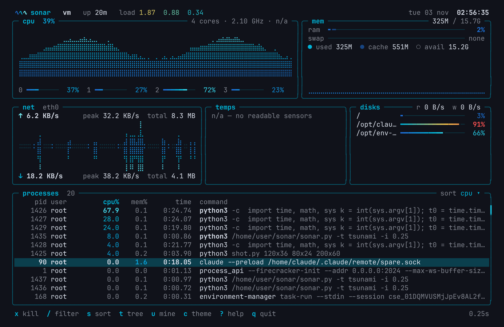
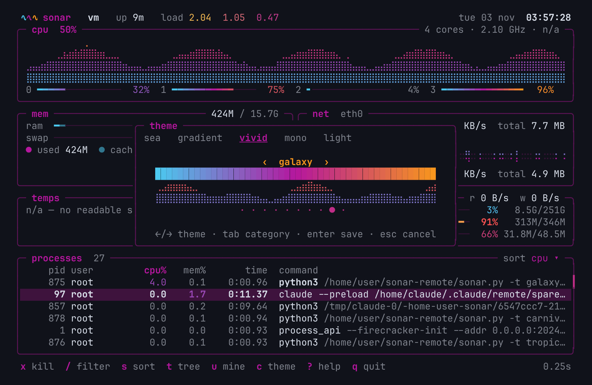
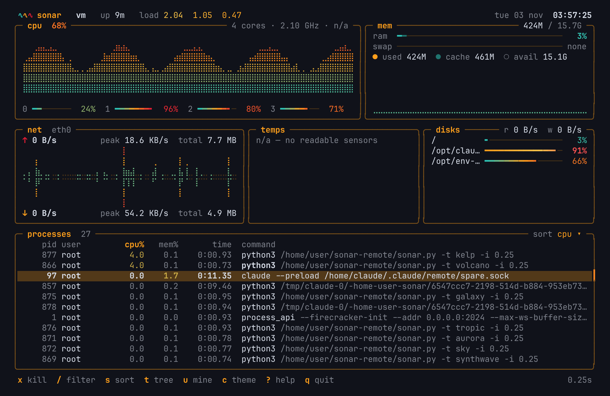
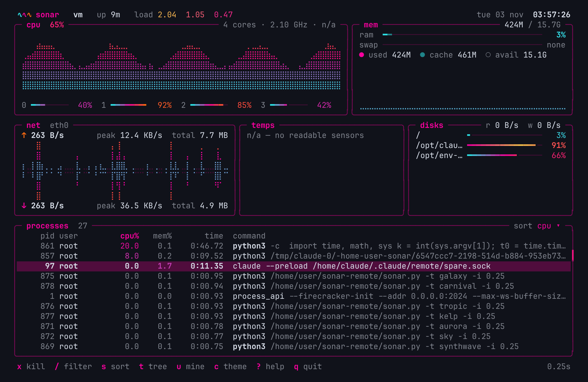
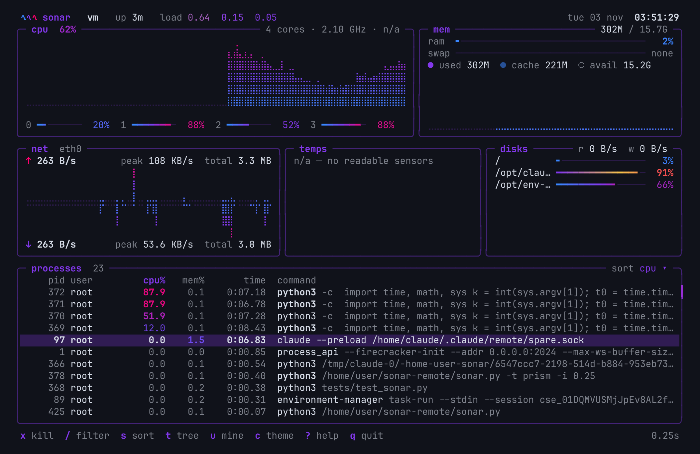
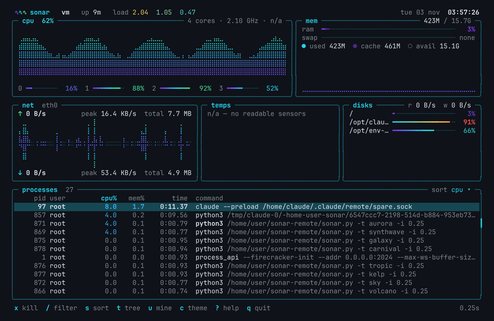
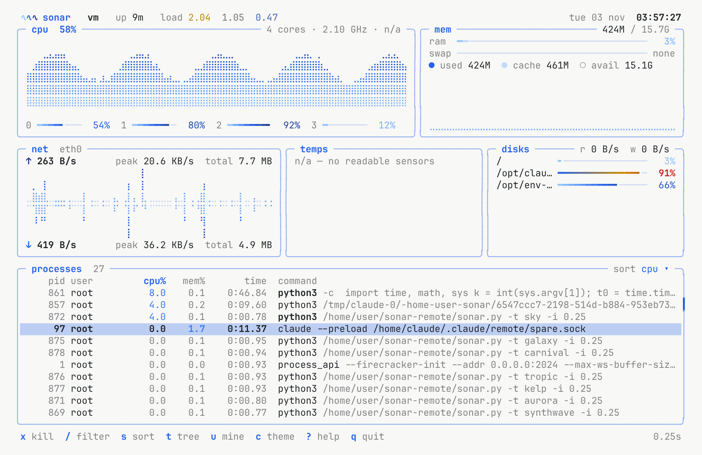
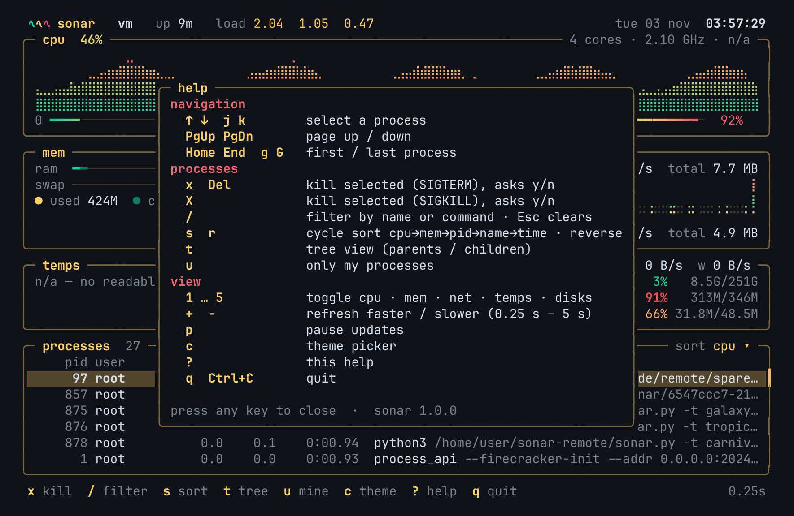
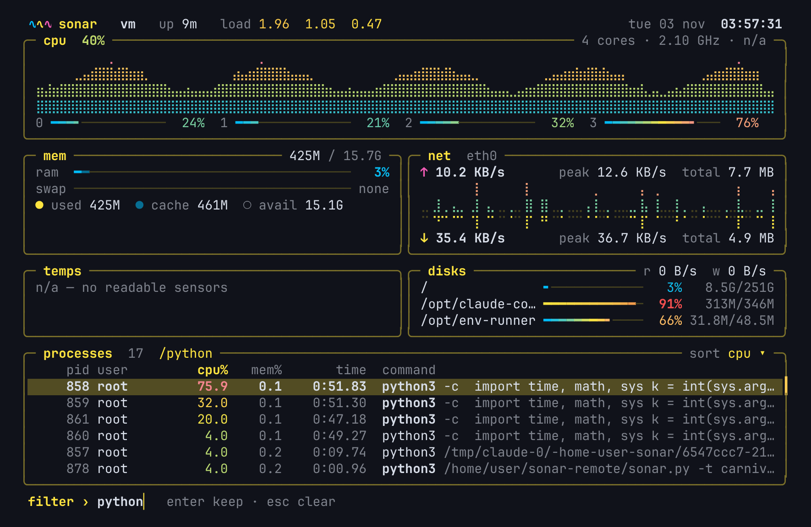
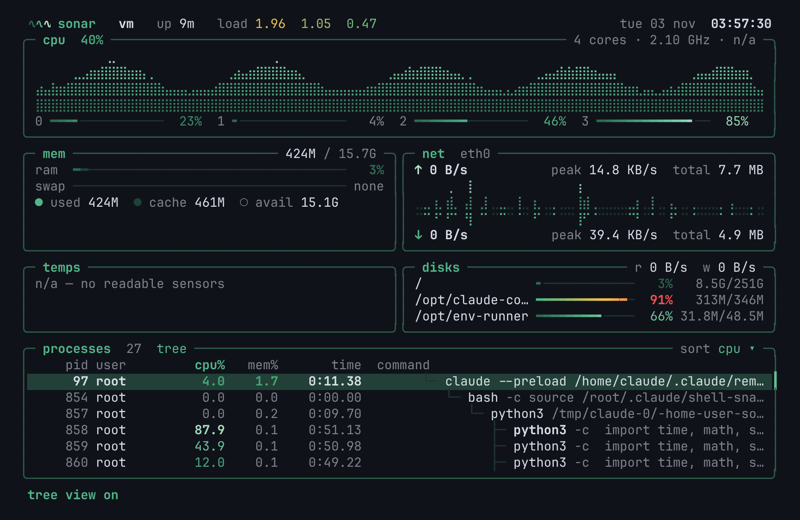

# sonar

Minimal system monitor for the Linux and Windows terminal.

## Install

You need Python 3.9 or newer.

**Linux**

```sh
curl -fsSL https://raw.githubusercontent.com/tfem1/sonar/main/install.sh | sh
```

**Windows** (PowerShell)

```powershell
irm https://raw.githubusercontent.com/tfem1/sonar/main/install.ps1 | iex
```

Then open a new terminal and type `sonar`.

<details><summary>Install with git, or uninstall</summary>

```sh
git clone https://github.com/tfem1/sonar
cd sonar
./install.sh                                          # Linux
powershell -ExecutionPolicy Bypass -File install.ps1  # Windows
```

Uninstall: `./install.sh --uninstall` or `install.ps1 -Uninstall`.
No git? Download the [ZIP](https://github.com/tfem1/sonar/archive/refs/heads/main.zip) and run the same script.

</details>

## How to use

**Start:** type `sonar`. Press `q` to quit.

**Change the colors:** press `c`.
- `←` `→` to try themes (the screen changes live)
- `Tab` to switch group: sea, gradient, vivid, mono, light
- `Enter` to keep the theme, `Esc` to cancel

You can also start with a theme directly: `sonar -t volcano`.
`sonar -l` lists all 50 themes.

**Processes:**
- `↑` `↓` to select one
- `/` to search by name, `Esc` to clear the search
- `x` then `y` to kill the selected process
- `s` to change the sort (cpu, mem, pid, name, time)
- `t` for the tree view, `u` for only your processes

**Screen:**
- `1` to `5` show or hide the cpu, mem, net, temps and disks panels
- `+` / `-` refresh faster or slower
- `p` pauses

Press `?` anytime to see all the keys.

**Update:** `sonar --update` downloads the latest version.

## Gallery

| | |
|---|---|
|  **tsunami** (default) |  **theme picker** `c` |
|  **volcano** |  **synthwave** |
|  **prism** |  **aurora** |
|  **sky** (light) |  **help** `?` |
|  **search** `/` |  **tree view** `t` |

## License

MIT
